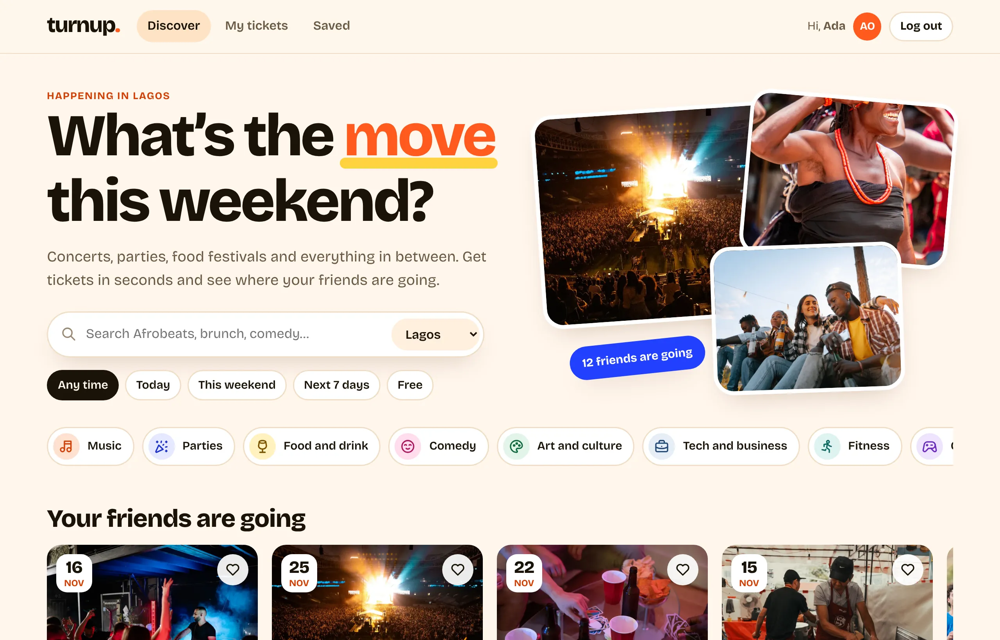
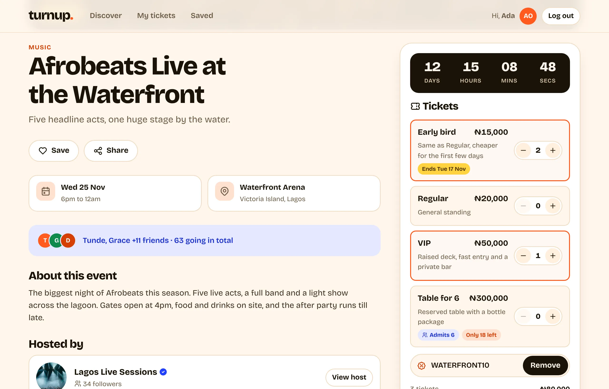
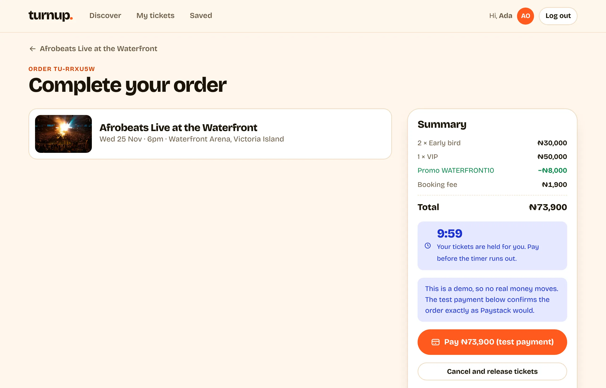
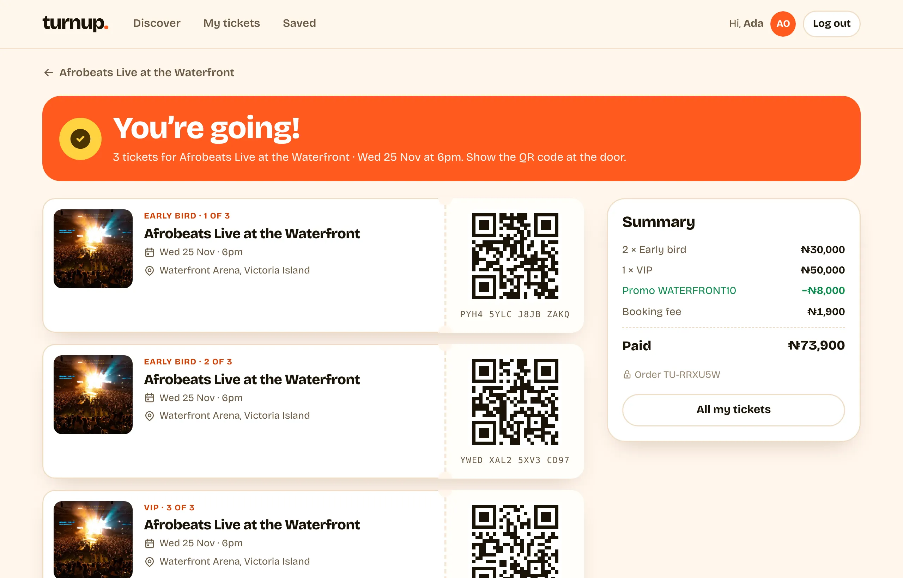
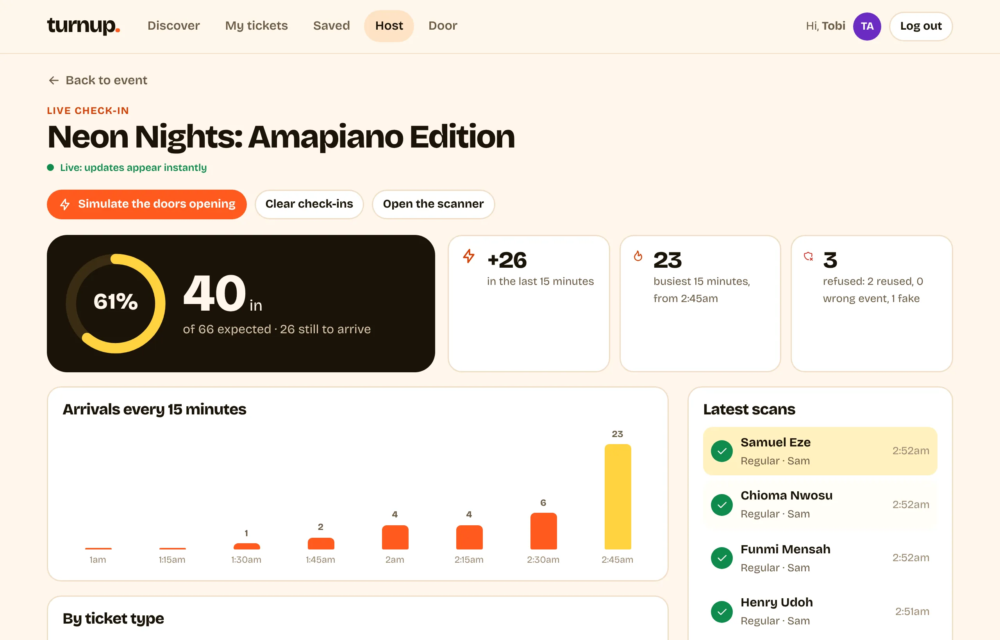
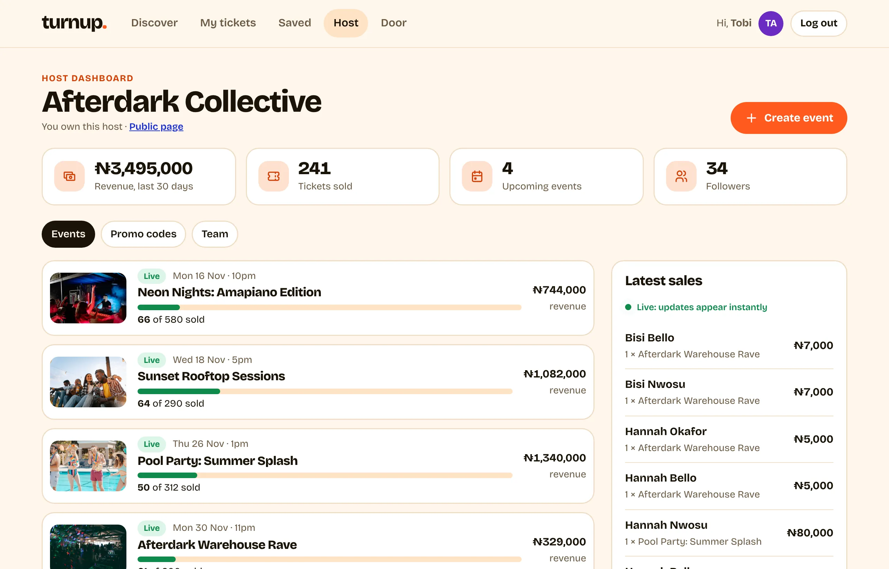
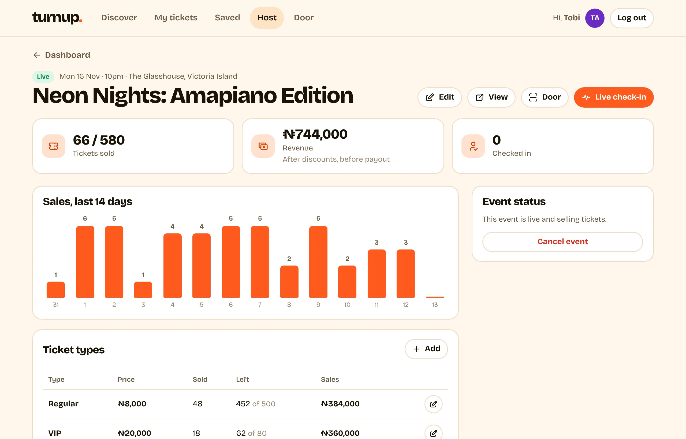
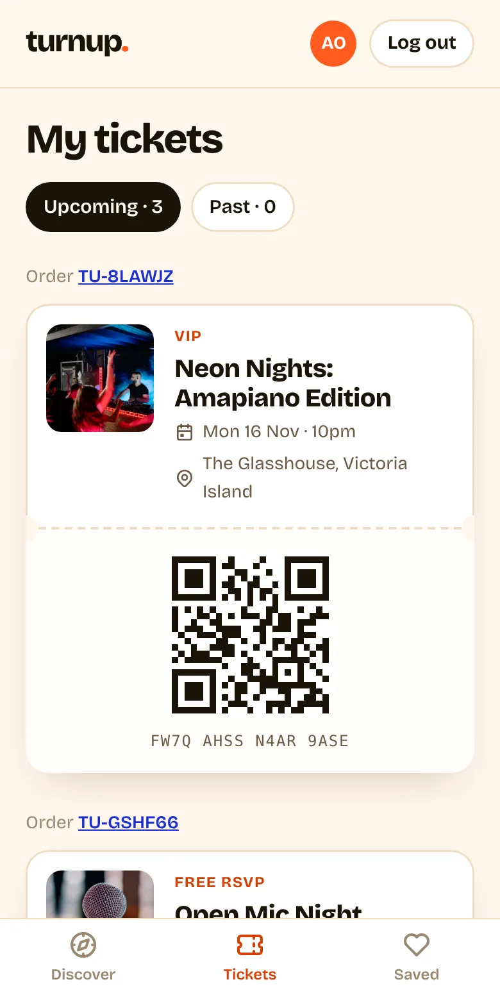
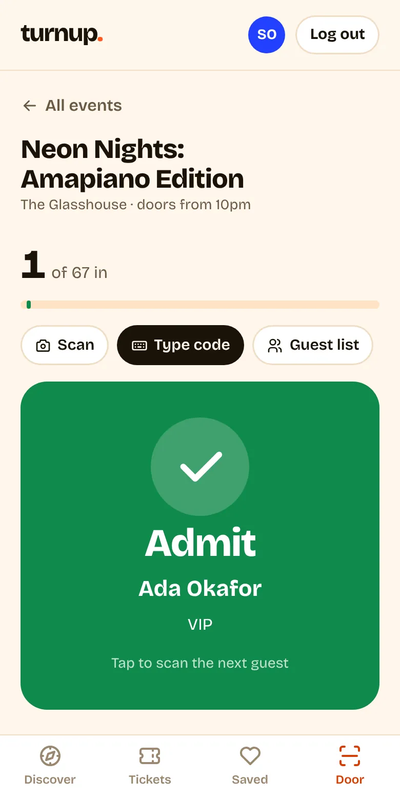
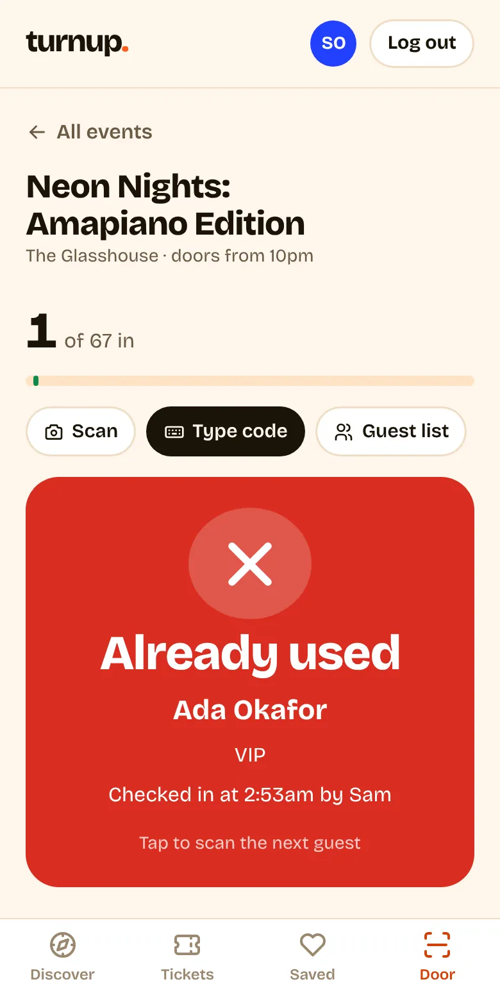

# Turnup

Find the move in your city. Turnup is an events and ticketing platform: guests discover concerts, parties, food
festivals and more, see which friends are going and buy tickets in seconds; hosts sell tickets and check guests in
at the door with QR codes.

**[Try the live demo](https://turnup-demo.netlify.app)** · no sign-up needed. Use the bar at the top to switch between
Guest, Host and Door, or open each in its own tab: buy a ticket as a guest, scan it as the door, and watch it land on
the host's live dashboard.



| Event page with ticket picker and promo code | Tickets held for 10 minutes at checkout |
| --- | --- |
|  |  |
| **QR tickets** | **Live check-in dashboard** |
|  |  |
| **Host dashboard** | **Per-event sales** |
|  |  |

<p align="center">
  
  &nbsp;
  
  &nbsp;
  
</p>

## Highlights

- **Never oversells.** Tickets are held for 10 minutes at checkout with one atomic database update. A load test of 500
  people rushing for 100 tickets sells exactly 100; the naive approach oversells by 552
- **QR check-in at the door** with any phone camera. Each ticket admits once, even if two doors scan the same screenshot at once
- **Live check-in dashboard** over WebSockets: arrivals every 15 minutes, refusals and a feed of every scan, updating instantly
- **Host dashboard**: create events and ticket types, promo codes, door staff and co-hosts, sales charts
- **Social discovery**: see which friends are going, follow hosts, save events, filter by city, date and category
- **Real payments** through Paystack, with prices always worked out on the server
- **51 API tests** across accounts, checkout, holds, check-in, the host dashboard and live updates

## Stack

| Layer | Technology |
| --- | --- |
| Front end | React 18, React Router 7, Vite |
| Back end | Node.js, Express (ES modules) |
| Database | MySQL 8 (MariaDB 10.6+ also works) |
| Auth | JWT in an httpOnly cookie, bcrypt password hashing, role-based access |
| Live updates | Socket.IO, authenticated with the same session cookie, one room per host |

## Features

- 28 sample events from 10 hosts across Lagos, Abuja and Ibadan, with real event photos
- Browse by city, category and date (today, this weekend, next 7 days), free events only, and search
- Date windows follow Lagos time, so "this weekend" means Friday 5pm to Sunday night wherever the server runs
- "Your friends are going" on every card and event page
- Event pages with a live countdown, ticket types with early-bird deadlines and tickets left
- Host pages with follower counts and upcoming events, plus follow and unfollow
- Save events to a personal list
- Ticket checkout: choose ticket types and quantities, apply promo codes, then pay with Paystack (or built-in test payments)
- Free RSVPs confirmed instantly, group tickets and tables that admit several people, early-bird prices that end on a date
- Prices, discounts and booking fees are always worked out on the server; the browser only sends ticket types and quantities
- Tickets are issued exactly once per payment, however many times Paystack or the buyer's browser reports it
- My tickets: festival-style passes with a QR code each, for upcoming and past events
- QR check-in at the door: scan with any phone or laptop camera, type the code, or find guests by name
- Each ticket admits once, even if two doors scan the same screenshot at the same moment; group tickets admit everyone in one scan
- Refusals say why: already used (with the time and who let them in), wrong event, or not a real ticket
- Every scan is logged, door staff only see their host's events, and owners can undo a mistaken check-in
- Host dashboard: revenue, tickets sold and followers at a glance, every event with a sales bar, and a live feed of sales
- Create events as drafts (previewable only by the host and co-hosts) and publish when ready; edit, unpublish or cancel
- Per-event page with a 14-day sales chart, ticket types (add, edit, delete), orders and check-ins
- Ticket quantities can be changed but never below what is sold or being paid for, enforced in one database statement
- Promo codes (percent or naira off, per event or for all events, with use limits and end dates) that hosts can switch off
- Team: owners add door staff (check-in only) or co-hosts (can also run events) by email
- Live check-in dashboard for the night: people in against expected, arrivals every 15 minutes, check-ins by ticket type,
  refused scans, the door team's counts and a feed of every scan, all updating instantly over WebSockets
- Sales and check-ins also update the host dashboard and every door's counter live, with no refreshing
- Live messages only say which event changed; screens then refetch through the permission-checked API, so no guest
  details are ever pushed to a browser, and door staff never receive sales figures
- Accounts with login protection (rate limiting, same error for wrong email or password, cross-site request blocking)

## Seat-safe ticket sales

When a big show goes on sale, hundreds of people hit "Get tickets" in the same second. Turnup holds tickets for
10 minutes at checkout and can never oversell, even then.

- **Holding is one atomic step.** `UPDATE ticket_tiers SET held = held + n WHERE id = ? AND sold + held + n <= quantity`.
  The database checks and changes the row while it is locked, so two buyers can never both take the last ticket.
  A `CHECK (sold + held <= quantity)` constraint backs it up at the database level.
- **Abandoned checkouts go back on sale.** Unpaid holds expire after 10 minutes. A sweeper runs every 30 seconds
  (and before anything that reads stock) using `FOR UPDATE SKIP LOCKED`, so it never blocks or fights with an order
  that is being paid at that moment. Buyers can also cancel and release tickets straight away.
- **Payments are confirmed exactly once.** The order row is locked, held tickets become sold, and tickets are issued.
  A payment that arrives after the hold ended still succeeds if tickets are left, and fails with a refund message if not.
- **Promo codes with limited uses** are reserved the same way, so a 5-use code is never used 6 times.
- **Deadlocks are retried.** Ticket types are always locked in the same order, and if the database still picks a
  transaction as a deadlock loser it is retried, which is the standard way to handle them.

`npm run load-test` (in `server`) proves it against the real API and database. Latest run:

| | Result |
| --- | --- |
| Buyers rushing at once | 500, wanting 652 tickets for 100 places |
| Throughput | 388 requests a second on a small cloud machine |
| Oversold | **0** (100 sold of 100) |
| Tickets issued vs paid | 100 issued for 100 paid, none twice |
| Buyers charged without tickets | 0 |
| Abandoned holds resold | 18 of 18 picked up by people who retried |
| Naive "check, then update" with the same rush | **oversold by 552 tickets** |

Full output: [docs/load-test-results.md](docs/load-test-results.md). Try a bigger run with `npm run load-test -- 1000 150`.

## How the live demo works

The hosted demo has no server or database, so it costs nothing to keep online and never goes to sleep. When the client
is built with `VITE_DEMO=true`, every API call is answered inside the browser by `client/src/demo/server.js`, which
follows the same rules as the Express API: server-style pricing, 10-minute holds, single-use tickets and host
permissions. The sample events, tickets and accounts are exported from MySQL with `npm run demo:export`, keeping
each event's clock time so a 10pm party is always at 10pm in the coming weeks. Live updates travel between tabs with
the browser's BroadcastChannel in place of Socket.IO. Anything a visitor does stays in their own browser, and
**Reset** starts over. The normal build leaves all of this out.

## Project structure

```
client/          React app (Vite)
  src/pages/     Discover, event, checkout, tickets, door and host screens
  src/demo/      Browser-only API used by the hosted demo
server/          Express API
  src/routes/    auth, events, hosts, orders, payments, check-in, host dashboard
  src/services/  pricing, orders and holds, Paystack, permissions
  src/realtime.js  Socket.IO rooms per host
  scripts/       database setup, sample data, load test, door simulation, demo export
  test/          API tests (node:test)
database/        MySQL schema
docs/            screenshots and load test results
```

## Design

"Sunset pop": warm cream, hot orange and cobalt with a sunshine-yellow accent, set in Bricolage Grotesque.

## Run it locally

You need Node 20+ and MySQL.

```bash
# 1. Create a database and user (in the mysql shell)
CREATE DATABASE turnup CHARACTER SET utf8mb4;
CREATE USER 'turnup'@'localhost' IDENTIFIED BY 'choose-a-password';
GRANT ALL ON turnup.* TO 'turnup'@'localhost';

# 2. Configure the server
cp server/.env.example server/.env    # then set DB_PASSWORD

# 3. Install everything and load sample events
npm run setup

# 4. Start both apps (two terminals)
npm run dev:server    # API on http://localhost:5080
npm run dev:client    # site on http://localhost:5175
```

Every sample account uses the password `turnup123`: `guest@turnup.demo` (has friends going to events) and
`host@turnup.demo` (runs Afterdark Collective) and `door@turnup.demo` (door staff for Afterdark Collective). Promo codes to try: `AFTERDARK`, `WATERFRONT10`, `FOODIE15` and `LAUGH50`. Running `npm run db:setup` again moves the sample events back into
the coming weeks, so they never go out of date.

## Watch the doors open

With the API running, `npm --prefix server run simulate-door` checks guests in to Neon Nights through the real API:
half arrived earlier in the night, the rest arrive one by one over a minute. Open **Host > Neon Nights > Live check-in**
first to watch it happen. `npm --prefix server run reset-door` clears the check-ins so you can run it again.

To run the browser-only demo locally instead: `cd client && npm run dev:demo`.

## Tests

```bash
npm test
```

## Roadmap

1. ~~Foundation: accounts, events, hosts, browsing, saving and following~~
2. ~~Tickets: checkout with Paystack, free RSVPs, promo codes and group tickets~~
3. ~~Seat-safe sales: 10-minute holds and no overselling under heavy load, with a load test~~
4. ~~QR tickets and door check-in~~
5. ~~Host dashboard: create events, ticket types, sales and co-hosts~~
6. ~~Live check-in dashboard~~
7. ~~Demo mode, screenshots and launch~~

## Photo credits

Event photos are from [Pexels](https://www.pexels.com) and used under the [Pexels licence](https://www.pexels.com/license/).
Each file in `client/public/img/events` is named after its Pexels photo ID; the original is at `https://www.pexels.com/photo/<id>/`.

---

**Author:** Ayomikunle Daramola · [LinkedIn](https://www.linkedin.com/in/ayomikunle-daramola-95b738260/)
